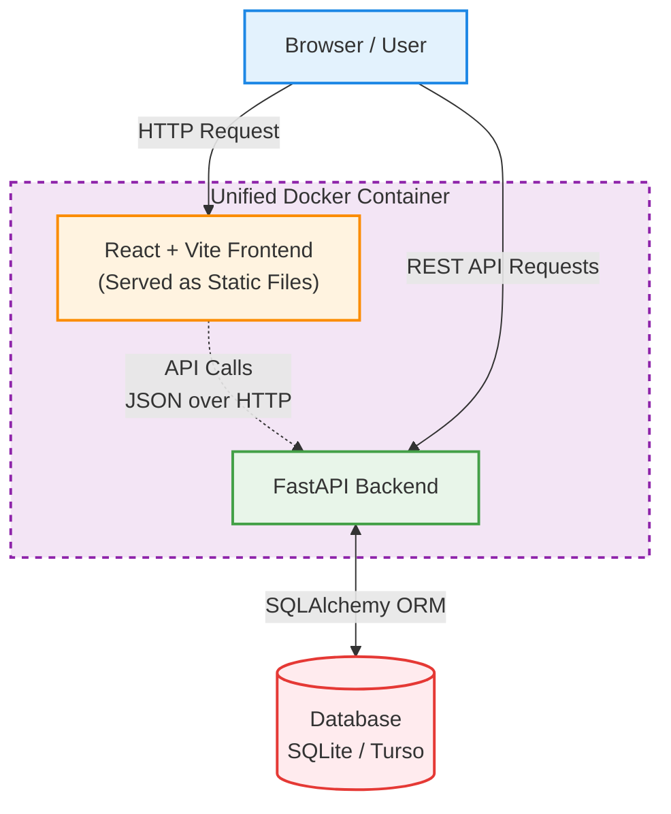
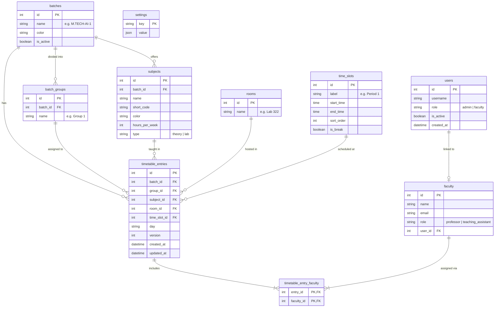
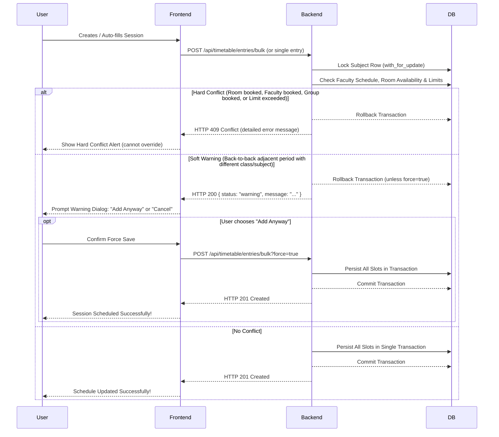

# NitaTime Architecture

This document provides a high-level overview of the NitaTime college timetable management system architecture.

## System Architecture

NitaTime is built using a modern, unified tech stack. In production, it is deployed as a single Docker container where the FastAPI backend serves both the API and the compiled React static files.

## Data Model Architecture

The database follows a relational model centered around timetable entries, supporting multi-faculty assignments, lab sub-groups, and physical rooms.

## Conflict Detection & Scheduling Flow

The system employs real-time constraint validation with optimistic locking (`version`), hard conflict prevention, and soft back-to-back warnings.

